# Marelight

## 短信登录

### 基于`session`实现短信登录

#### 发送短信验证码

##### 流程图

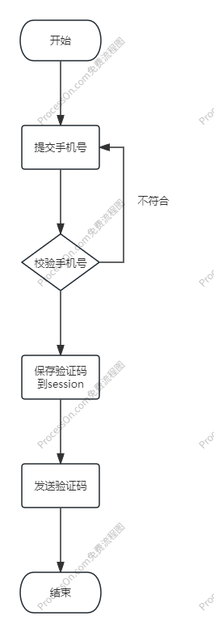

##### 服务层代码实现

```java
    public Result sendCodeBySession(String phone, HttpSession session) {
        // 1.校验手机号
        if (RegexUtils.isPhoneInvalid(phone)) {
            return Result.fail("手机号格式错误!");
        }
        // 2.随机生成验证码
        String code = RandomUtil.randomNumbers(6);
        // 3.在session中存入验证码
        session.setAttribute("code", code);
        // 4.发送验证码
        log.info("发送短信验证码成功, 验证码: {}", code);

        return Result.ok();
    }
```


#### 短信验证码登录、注册

##### 流程图

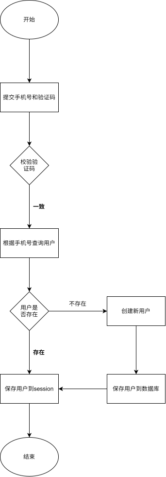

##### 服务层代码实现

```java
    public Result loginBySession(LoginFormDTO loginForm, HttpSession session) {
        // 1.校验手机号
        String phone = loginForm.getPhone();
        if (RegexUtils.isPhoneInvalid(phone)) {
            return Result.fail("手机号格式错误！");
        }

        // 2.基于Seession校验验证码
        Object cacheCode = session.getAttribute("code"); // 可以考虑更“优雅”
        String code = loginForm.getCode();
        if (cacheCode == null || !cacheCode.equals(code)) {
            return Result.fail("验证码错误");
        }

        // 3.根据手机号查询用户
        User user = query().eq("phone", phone).one();

        // 4.判断用户是否存在
        if (user == null) {
            // 创建新用户
            user = createUserWithPhone(phone);
        }
        // 5.保存用户信息到session中
        session.setAttribute("user", user);

        return Result.ok();
    }
```


#### 基于session校验登录状态

##### 流程图

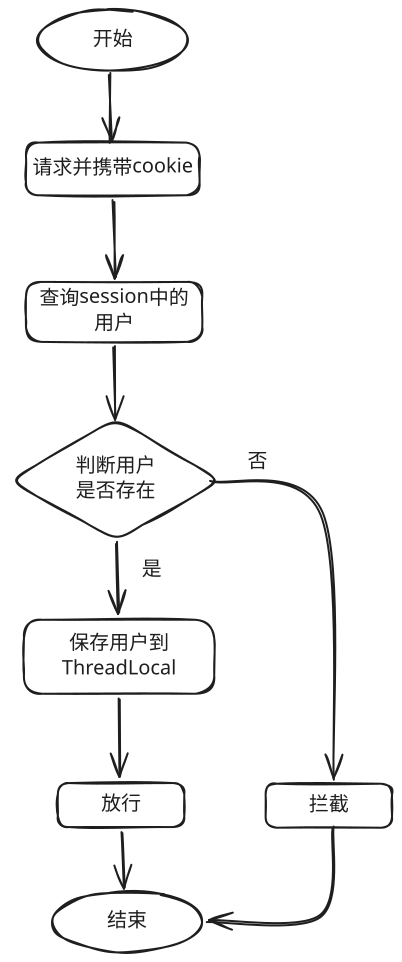

##### 代码实现

拦截器中实现**校验登录**功能：

```java
    public boolean preHandle(HttpServletRequest request, HttpServletResponse response, Object handler) {
        // 1.从session中获取用户信息
        HttpSession session = request.getSession();
        UserDTO user = (UserDTO) session.getAttribute("user");
        // 2.判断用户是否存在
        if (user == null) {
            // 不存在则拦截，并返回 401 状态码
            response.setStatus(401);
            return false;
        }
        // 3.保存用户信息到ThreadLocal中
        UserHolder.saveUser(user);
        // 否则放行
        return true;
    }
```

控制层中判断

#### 补充复习

##### Cookie会话跟踪技术

优点：

- `HTTP`协议中支持的技术

缺点：

- 移动端`APP`无法使用Cookie
- 不安全，用户可以自己禁用Cookie
- Cookie不能跨域

##### Session会话跟踪技术

优点：

- 存储在服务器，安全

缺点：

- 服务器集群环境下无法直接使用Session
- Cookie的缺点

#### 目前存在的问题并解决

##### 问题提出

1. 验证码未与手机号绑定，存在跨号登录漏洞。
   - **问题**：验证码的签发对象与校验对象不一致，导致验证码可被跨账号使用。
   - **解决思路**：验证码绑定申请手机号，校验时做一致性匹配。

2. 服务器集群下Session会话状态未集中存储
   - 问题：验证码存储于单机本地Session，未做分布式共享。当发送与校验请求被负载均衡分发到不同节点时，B节点读取不到A节点保存的验证码，导致校验失败。
   - 解决思路：将验证码等会话状态从本地内存迁移到集中式存储（如Redis），实现集群内共享，保证任意节点都能读取和校验。

3. 验证码未做一次性消费，存在重复使用/重放漏洞

   - 问题：验证码校验通过后未及时失效，同一验证码可被重复用于登录。

   - 解决思路：验证码校验通过或过期后立即失效（删除或标记已使用），确保一次性消费，防止重复使用。

##### 问题解决

确保验证码一次性消费：在校验成功后要把验证码删除

优化：让校验过程更加健壮——时间不能超过过期时间、错误次数不能超过最大错误次数

```java
    @Override
    public Result loginBySession(LoginFormDTO loginForm, HttpSession session) {
        // 1.校验手机号
        String phone = loginForm.getPhone();
        if (RegexUtils.isPhoneInvalid(phone)) {
            return Result.fail(MessageConstants.PHONE_INVALID);
        }

        /**
         * 2.基于Session校验验证码
         *  - 时间不能超过过期时间
         *  - 错误次数不能超过最大错误次数
         */
        Object cacheCode = session.getAttribute(SessionConstants.LOGIN_CODE);
        // session中未存入验证码
        if (cacheCode == null) {
            return Result.fail(MessageConstants.CODE_INVALID);
        }
        // 不能超过过期时间
        Long expireAt = (Long) session.getAttribute(SessionConstants.LOGIN_CODE_EXPIRE);
        if (expireAt == null || System.currentTimeMillis() > expireAt) {
            removeLoginCode(session);
            return Result.fail(MessageConstants.CODE_EXPIRED);
        }
        // 不能超过最大错误次数
        Integer errors = (Integer) session.getAttribute(SessionConstants.LOGIN_CODE_ERRORS);
        if (errors != null && errors >= SessionConstants.MAX_CODE_ERRORS) {
            removeLoginCode(session);
            return Result.fail(MessageConstants.CODE_ERROR_LIMIT);
        }
        // 验证码验证
        String code = loginForm.getCode();
        if (!cacheCode.equals(code)) {
            session.setAttribute(SessionConstants.LOGIN_CODE_ERRORS, (errors == null ? 0 : errors) + 1);
            return Result.fail(MessageConstants.CODE_INVALID);
        }

        // 3.到这里验证码验证成功, 删除验证码
        removeLoginCode(session);

        // 4.根据手机号查询用户
        User user = query().eq("phone", phone).one();

        // 5.判断用户是否存在
        if (user == null) {
            // 创建新用户
            user = createUserWithPhone(phone);
        }
        // 6.保存用户信息到session中
        //  BeanUtil.copyProperties(user, UserDTO.class): 将user赋值到UserDTO
        session.setAttribute(SessionConstants.LOGIN_USER, BeanUtil.copyProperties(user, UserDTO.class)); // hutool工具类

        return Result.ok();
    }

```

### 基于`redis`实现短信登录

#### 发送短信验证码

##### 流程图

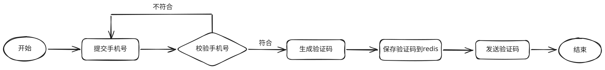

##### 代码实现

```java
    public Result sendCodeByRedis(String phone) {
        // 1.校验手机号
        if (RegexUtils.isPhoneInvalid(phone)) {
            return Result.fail(MessageConstants.PHONE_INVALID);
        }
        // 2.随机生成6位验证码
        String code = RandomUtil.randomNumbers(6); // hutool工具类
        // 3.验证码存入redis，键带手机号，2分钟过期
        stringRedisTemplate.opsForValue().set( // redis类型: string
                RedisConstants.LOGIN_CODE_KEY + phone, // key -> login:code:手机号
                code, // value -> 验证码
                RedisConstants.LOGIN_CODE_TTL, // 有效期
                TimeUnit.MINUTES // 时间单位
        );
        // 4.发送验证码,用日志模拟发送过程
        log.debug("发送短信验证码成功，验证码：{}", code);
        // 5.返回成功结果
        return Result.ok();
    }
```

#### 短信验证码登录、注册

##### 流程图

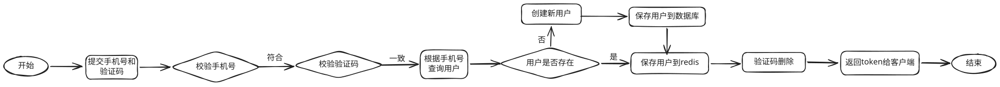

##### 代码实现

```java
    public Result loginByRedis(LoginFormDTO loginForm) {
        // 1.校验手机号
        String phone = loginForm.getPhone();
        if (RegexUtils.isPhoneInvalid(phone)) {
            return Result.fail(MessageConstants.PHONE_INVALID);
        }
        // 2.从redis校验验证码，键按手机号区分
        String cacheCode = stringRedisTemplate.opsForValue().get(RedisConstants.LOGIN_CODE_KEY + phone); // key -> login:code:手机号
        String code = loginForm.getCode();
        if (cacheCode == null || !cacheCode.equals(code)) {
            return Result.fail(MessageConstants.CODE_INVALID);
        }
        // 3.根据手机号查询用户是否存在
        User user = query().eq("phone", phone).one(); // 使用mybatis-plus进行数据库查询
        // 4.如果用户不存在,则创建用户
        if (user == null) {
            user = createUserWithPhone(phone);
        }
        // 5.只把UserDTO写入redis，避免保存密码
        String token = UUID.randomUUID().toString(true); // 获取用户令牌
        String tokenKey = RedisConstants.LOGIN_USER_KEY + token; // 用户的键
        UserDTO userDTO = BeanUtil.copyProperties(user, UserDTO.class); // User转成UserDTO
        Map<String, Object> userMap = BeanUtil.beanToMap(userDTO, new HashMap<>(), // hutool工具类
                CopyOptions.create()
                        .setIgnoreNullValue(true)   // 空值不进入hash
                        .setFieldValueEditor((fieldName, fieldValue) -> fieldValue.toString())); // 值转为String
        stringRedisTemplate.opsForHash().putAll(tokenKey, userMap); // 用户信息存入hash
        stringRedisTemplate.expire(tokenKey, RedisConstants.LOGIN_USER_TTL, TimeUnit.MINUTES); // 设置令牌时间
        // 6.验证码只用一次
        stringRedisTemplate.delete(RedisConstants.LOGIN_CODE_KEY + phone);
        // 7.返回token
        return Result.ok(token);
    }
```

#### 校验登录状态

##### 流程图

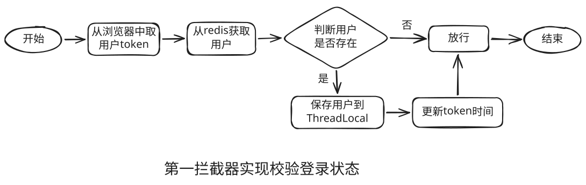

##### 代码实现

```java
    public boolean preHandle(HttpServletRequest request, HttpServletResponse response, Object handler) {
        // 1.从浏览器中拿取 token
        String token = request.getHeader("authorization");
        if (StrUtil.isBlank(token)) {
            return true;
        }
        // 2.从redis拿取用户信息
        String key = RedisConstants.LOGIN_USER_KEY + token;
        Map<Object, Object> userMap = stringRedisTemplate.opsForHash().entries(key);
        // 3.判断用户是否存在
        if (userMap.isEmpty()) {
            // 不存在则直接放行
            return true;
        }
        // 4.将用户信息转成UserDTO并存入线程中
        UserDTO userDTO = BeanUtil.fillBeanWithMap(userMap, new UserDTO(), false);
        UserHolder.saveUser(userDTO);
        // 5.更新令牌时间
        stringRedisTemplate.expire(key, RedisConstants.LOGIN_USER_TTL, TimeUnit.SECONDS);
        return true;
    }
```

### 优化一

#### token有效期优化

- 设置最长有效期
- 只有当有效期小于1/3时才续期

设置令牌的最大有效期，可防止攻击者在窃取用户 token 后，通过持续续期长期维持未授权访问。

```java
    public boolean preHandle(HttpServletRequest request, HttpServletResponse response, Object handler) {
        // 1.从浏览器中拿取 token
        String token = request.getHeader("authorization");
        if (StrUtil.isBlank(token)) {
            return true;
        }
        // 2.从redis拿取用户信息。旧的Hash会话类型不匹配时删掉，让用户重新登录
        String key = RedisConstants.LOGIN_USER_KEY + token;
        String json = readSession(key);
        if (StrUtil.isBlank(json)) {
            return true;
        }
        LoginSession session = JSONUtil.toBean(json, LoginSession.class);
        if (session == null || session.getUser() == null) {
            return true;
        }
        // 3.超过绝对上限则删除token
        long now = System.currentTimeMillis();
        if (now - session.getLoginAt() >= TimeUnit.DAYS.toMillis(RedisConstants.LOGIN_USER_ABSOLUTE_TTL)) {
            stringRedisTemplate.delete(key);
            return true;
        }
        // 4.将用户信息存入线程中
        UserHolder.saveUser(session.getUser());
        // 5.剩余时间不足三分之一时再续期
        refreshIfNeeded(key, now, session.getLoginAt());
        return true;
    }

```

续期逻辑：

```java
    private void refreshIfNeeded(String key, long now, long loginAt) {
        long slidingSeconds = TimeUnit.MINUTES.toSeconds(RedisConstants.LOGIN_USER_TTL);
        Long remain = stringRedisTemplate.getExpire(key, TimeUnit.SECONDS);
        if (remain != null && remain > slidingSeconds / 3) {
            return;
        }
        long absoluteRemainSeconds = TimeUnit.DAYS.toSeconds(RedisConstants.LOGIN_USER_ABSOLUTE_TTL)
                - TimeUnit.MILLISECONDS.toSeconds(now - loginAt);
        if (absoluteRemainSeconds <= 0) {
            stringRedisTemplate.delete(key);
            return;
        }
        stringRedisTemplate.expire(key, Math.min(slidingSeconds, absoluteRemainSeconds), TimeUnit.SECONDS);
    }
```

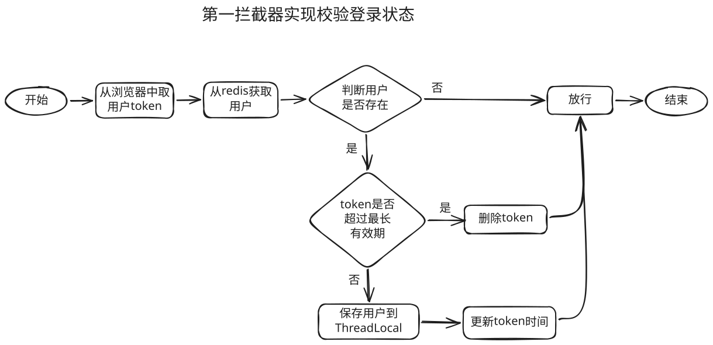

#### 验证码优化

- 限制同一手机号、同一ip发送验证码次数
- 限制校验错误次数
- 限制发送间隔
- 验证码用安全随机数生成，Redis中存哈希

##### 发送短信验证码优化

###### 流程图

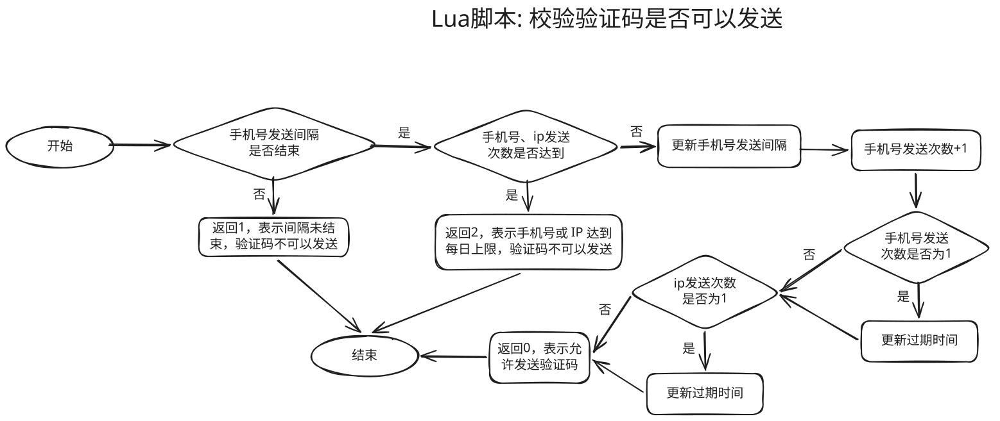

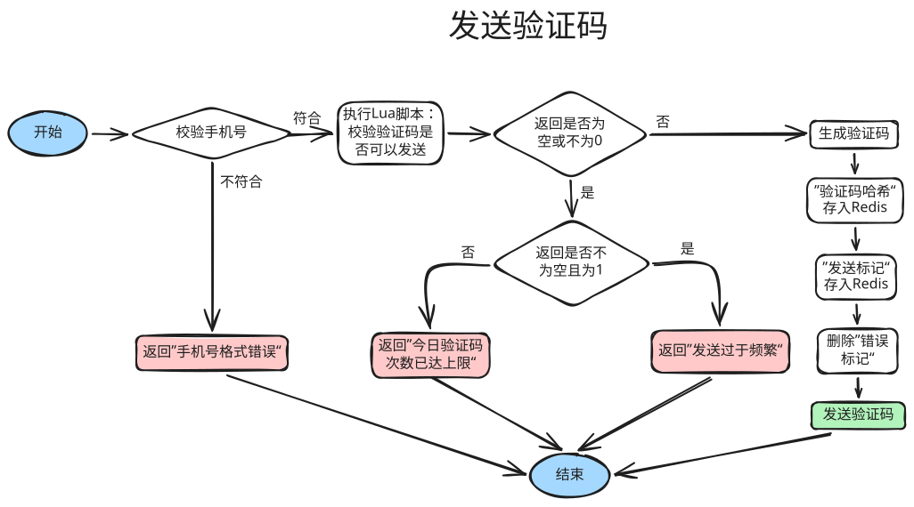

###### 代码实现

Lua脚本：

```lua
if redis.call('EXISTS', KEYS[1]) == 1 then
    return 1
end
local phone = tonumber(redis.call('GET', KEYS[2]) or '0')
local ip = tonumber(redis.call('GET', KEYS[3]) or '0')
if phone >= tonumber(ARGV[2]) or ip >= tonumber(ARGV[3]) then
    return 2
end
redis.call('SET', KEYS[1], '1', 'EX', ARGV[1])
local phoneCount = redis.call('INCR', KEYS[2])
if phoneCount == 1 then
    redis.call('EXPIRE', KEYS[2], ARGV[4])
end
local ipCount = redis.call('INCR', KEYS[3])
if ipCount == 1 then
    redis.call('EXPIRE', KEYS[3], ARGV[4])
end
return 0
```

代码：

```java
    public Result sendCodeByRedis(String phone, String clientIp) {
        // 1.校验手机号
        if (RegexUtils.isPhoneInvalid(phone)) {
            return Result.fail(MessageConstants.PHONE_INVALID);
        }
        // 2.间隔未到不扣每日次数；达到上限直接返回
        Long limit = stringRedisTemplate.execute(
                SEND_LIMIT_SCRIPT,
                List.of(
                        RedisConstants.LOGIN_CODE_INTERVAL_KEY + phone,
                        RedisConstants.LOGIN_CODE_PHONE_COUNT_KEY + phone,
                        RedisConstants.LOGIN_CODE_IP_COUNT_KEY + clientIp
                ),
                String.valueOf(RedisConstants.LOGIN_CODE_INTERVAL_TTL),
                String.valueOf(RedisConstants.LOGIN_CODE_PHONE_LIMIT),
                String.valueOf(RedisConstants.LOGIN_CODE_IP_LIMIT),
                String.valueOf(RedisConstants.LOGIN_CODE_COUNT_TTL)
        );
        if (limit == null || limit != SEND_OK) {
            if (limit != null && limit == SEND_FREQUENT) {
                return Result.fail(MessageConstants.CODE_SEND_FREQUENT);
            }
            return Result.fail(MessageConstants.CODE_SEND_LIMIT);
        }
        // 3.生成验证码。Redis 只存哈希，明文只打到日志里便于测试
        String code = String.format("%06d", SECURE_RANDOM.nextInt(1_000_000));
        stringRedisTemplate.opsForValue().set(
                RedisConstants.LOGIN_CODE_KEY + phone,
                DigestUtil.sha256Hex(code),
                RedisConstants.LOGIN_CODE_TTL,
                TimeUnit.MINUTES
        );
        // 标记验证码已生成
        stringRedisTemplate.opsForValue().set(
                RedisConstants.LOGIN_CODE_MARK_KEY + phone,
                "1",
                RedisConstants.LOGIN_CODE_MARK_TTL,
                TimeUnit.MINUTES
        );
        stringRedisTemplate.delete(RedisConstants.LOGIN_CODE_ERRORS_KEY + phone);
        log.debug("发送短信验证码成功，验证码：{}", code);
        return Result.ok();
    }
```

##### 验证码登录注册

###### 流程图

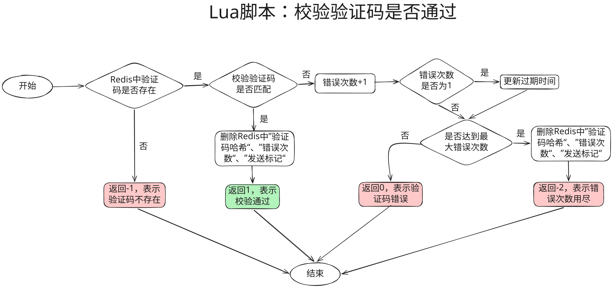

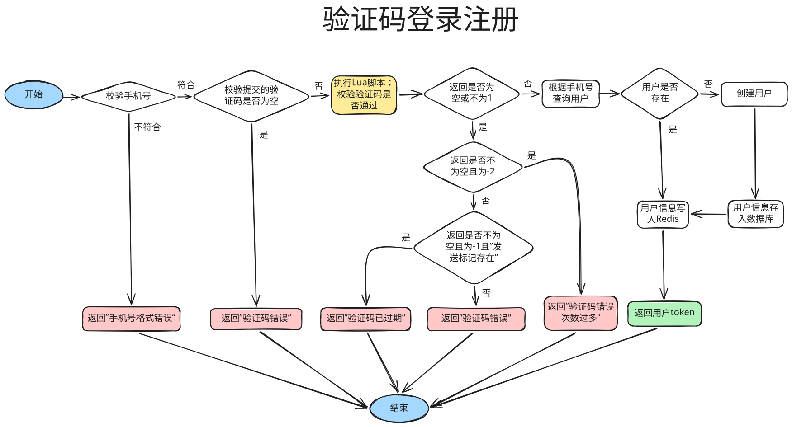

###### 代码实现

Lua脚本：

```lua
local stored = redis.call('GET', KEYS[1])
if not stored then
    return -1
end
if stored ~= ARGV[1] then
    local errors = redis.call('INCR', KEYS[2])
    if errors == 1 then
        redis.call('EXPIRE', KEYS[2], ARGV[3])
    end
    if errors >= tonumber(ARGV[2]) then
        redis.call('DEL', KEYS[1], KEYS[2], KEYS[3])
        return -2
    end
    return 0
end
redis.call('DEL', KEYS[1], KEYS[2], KEYS[3])
return 1
```

代码：

```java
    public Result loginByRedis(LoginFormDTO loginForm) {
        // 1.校验手机号
        String phone = loginForm.getPhone();
        if (RegexUtils.isPhoneInvalid(phone)) {
            return Result.fail(MessageConstants.PHONE_INVALID);
        }
        // 2.原子校验验证码。比对的是哈希，通过后立刻删除
        String code = loginForm.getCode();
        if (StrUtil.isBlank(code)) {
            return Result.fail(MessageConstants.CODE_INVALID);
        }
        Long verified = stringRedisTemplate.execute(
                VERIFY_CODE_SCRIPT,
                List.of(
                        RedisConstants.LOGIN_CODE_KEY + phone,
                        RedisConstants.LOGIN_CODE_ERRORS_KEY + phone,
                        RedisConstants.LOGIN_CODE_MARK_KEY + phone
                ),
                DigestUtil.sha256Hex(code),
                String.valueOf(SessionConstants.MAX_CODE_ERRORS),
                String.valueOf(TimeUnit.MINUTES.toSeconds(RedisConstants.LOGIN_CODE_TTL))
        );
        if (verified == null || verified != VERIFY_OK) {
            if (verified != null && verified == VERIFY_LIMIT) {
                return Result.fail(MessageConstants.CODE_ERROR_LIMIT);
            }
            if (verified != null && verified == VERIFY_MISSING
                    && Boolean.TRUE.equals(stringRedisTemplate.hasKey(RedisConstants.LOGIN_CODE_MARK_KEY + phone))) {
                return Result.fail(MessageConstants.CODE_EXPIRED);
            }
            return Result.fail(MessageConstants.CODE_INVALID);
        }
        // 3.根据手机号查询用户是否存在
        User user = query().eq("phone", phone).one(); // 使用mybatis-plus进行数据库查询
        // 4.如果用户不存在,则创建用户
        if (user == null) {
            user = createUserWithPhone(phone);
        }
        // 5.只把用户信息和登录时间写入redis，避免保存密码。SET 与过期时间一次完成
        String token = UUID.randomUUID().toString(true); // 获取用户令牌
        String tokenKey = RedisConstants.LOGIN_USER_KEY + token; // 用户的键
        LoginSession session = new LoginSession();
        session.setUser(BeanUtil.copyProperties(user, UserDTO.class));
        session.setLoginAt(System.currentTimeMillis());
        stringRedisTemplate.opsForValue().set(
                tokenKey,
                JSONUtil.toJsonStr(session),
                RedisConstants.LOGIN_USER_TTL,
                TimeUnit.MINUTES
        );
        // 6.返回token
        return Result.ok(token);
    }
```

##### 总结：key的生命周期

1. `login:code:{phone}`：用于存入验证码
   - 生：生成验证码
   - 死：
     - 过期
     - 验证码校验成功
     - 达到最大错误次数
   - 更新：无
2. `login:code:interval:{phone}`：用于标记同一手机号发送验证码间隔是否结束
   - 生：生成验证码
   - 死：
     - 过期
   - 更新：无
3. `login:code:count:phone:{phone}`：用于统计同一手机号24小时内发送验证码的次数
   - 生：24小时内该手机号第一次发送验证码
   - 死：过期
   - 更新：该手机号每次发送验证码
4. `login:code:count:ip:{clientIp}`：用于统计同一`IP`24小时内发送验证码的次数
   - 生：24小时内该`IP`第一次发送验证码
   - 死：过期
   - 更新：该`IP``每次发送验证码

5. `login:code:mark:{phone}`：发送标记，用于标记验证码是否发送

   - 生：生成验证码

   - 死：
     - 过期
     - 验证码校验成功
     - 达到最大错误次数

   - 更新：无

6. `login:code:errors:{phone}`：用于统计同一手机号校验验证码的错误次数
   - 生：该手机号校验验证码第一次验证失败
   - 死：
     - 过期
     - 验证码校验成功
     - 达到最大错误次数
     - 生成新的验证码
   - 更新：该手机号校验验证码验证失败


